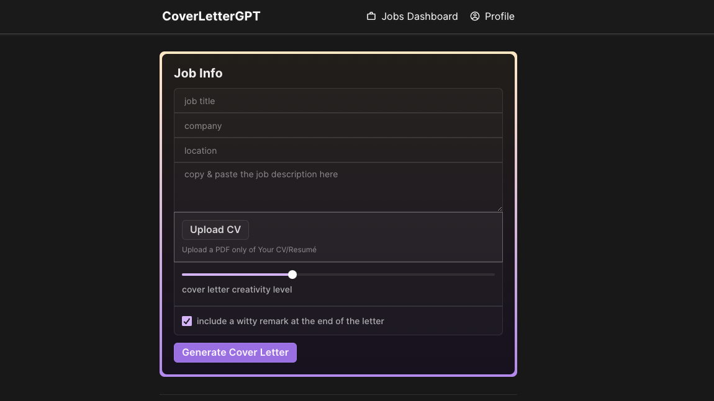

# CoverLetterGPT.xyz

CoverLetterGPT.xyz is an AI-powered application designed to help you effortlessly create personalized and effective cover letters. Utilizing the power of OpenAI's language models, it crafts compelling letters based on your resume and job descriptions. Check out the live application at [coverlettergpt.xyz](http://coverlettergpt.xyz)!

## Running it locally

After cloning this repo, you can run the application locally by following these steps:

1.  Install [Wasp](https://wasp.sh) by running `curl -sSL https://get.wasp-lang.dev/installer.sh | sh` in your terminal.
2.  Create a `.env.server` file in the root of the project.
3.  Copy the contents of `env.server.example` to `.env.server` and fill in your API keys.
4.  Ensure you have a PostgreSQL database connected and running. Here are two quick options:
    *   Run `wasp start db` from the project root (this requires Docker; if you're on macOS and don't have Docker, you can install it via `brew install docker-machine docker` and then start the Docker desktop application). This command will start a PostgreSQL database and configure it for you.
    *   Alternatively, provision a PostgreSQL database on a platform like [Railway](https://railway.app). Copy the connection URL from your database settings and paste it as `DATABASE_URL=<your-postgres-connection-url>` into your `.env.server` file.
5.  Run `wasp db migrate-dev` to apply database migrations.
6.  Run `wasp start` to launch the application.
7.  Open `http://localhost:3000` in your browser. Your Node.js server will be running on port `3001`.
8.  For the best developer experience, install the [Wasp extension for VSCode](https://marketplace.visualstudio.com/items?itemName=wasp-lang.wasp).

## How it works

[CoverLetterGPT.xyz](http://coverlettergpt.xyz) was built using a combination of powerful and efficient tools:

- 🐝 [Wasp](https://wasp.sh) - A full-stack framework simplifying the development of React, Node.js, and Prisma applications by reducing boilerplate.
- 💾 [Prisma](https://www.prisma.io/) - A modern ORM for database interactions, seamlessly managed by Wasp.
- 🐘 [PostgreSQL](https://www.postgresql.org/) - The robust relational database storing all application data.
- 🎨 [Chakra-ui](https://chakra-ui.com/) - A React component library enabling the rapid development of accessible and aesthetically pleasing UIs.
- 🤖 [OpenAI](https://openai.com/) - Leverages GPT-4o and gpt-4o-mini models through direct `fetch` API calls to generate personalized cover letters.
- 💸 [Stripe](https://stripe.com/) - Securely handles subscription and credit-based payments.
- ⚡️ [Lightning / Bolt11](https://github.com/bitcoinjs/bolt11) - Facilitates Bitcoin Lightning payments as an alternative payment method.
- 📧 [SendGrid](https://sendgrid.com/) - Manages the sending of email notifications, such as subscription expiry alerts.

[Wasp](https://wasp.sh) serves as the backbone, allowing core application features to be defined in the `main.wasp` configuration file. Wasp then constructs and integrates these features (including React for the frontend, Express.js for the server, and Prisma for database access) into a cohesive application. This significantly cuts down on boilerplate code, especially for functionalities like Google Authentication, which Wasp can set up with minimal configuration. Explore the `main.wasp` file for more details.

[Chakra-ui](https://chakra-ui.com/) is instrumental in building clean and responsive UIs with ease. Its component-based architecture, while built on React, offers extensive customization options, accelerating the design process compared to utility-first CSS frameworks like Tailwind.

Details on the specific prompts and configurations for OpenAI API interactions can be found in the `src/server/actions.ts` file.

[Stripe](https://stripe.com/) integration simplifies payment processing. The system is configured to handle payments for different service tiers or credit packs, updating user status in the database upon successful payment.

[Lightning / Bolt11](https://github.com/bitcoinjs/bolt11) provides the functionality for Bitcoin Lightning payments, including invoice generation and payment confirmation (see `src/server/ln.ts` for implementation details).

The application also implements a cron job to send email notifications about subscription expiry via [SendGrid](https://sendgrid.com/).

## ✨ Features

- AI-powered cover letter generation using OpenAI models.
- User registration with email/password and Google Authentication.
- Comprehensive job description management (create, read, update, delete).
- User profiles for managing preferences, viewing generation history, and handling subscriptions.
- Secure payment processing via Stripe for various subscription tiers and credit purchases.
- Alternative payment options through Bitcoin Lightning network.
- Automated email notifications for events like subscription expiry, powered by SendGrid.
- Flexibility to choose between different OpenAI GPT models (e.g., GPT-4o, gpt-4o-mini) for cover letter generation.

If you have any other questions or suggestions, feel free to reach out on [Twitter](https://twitter.com/hot_town).
